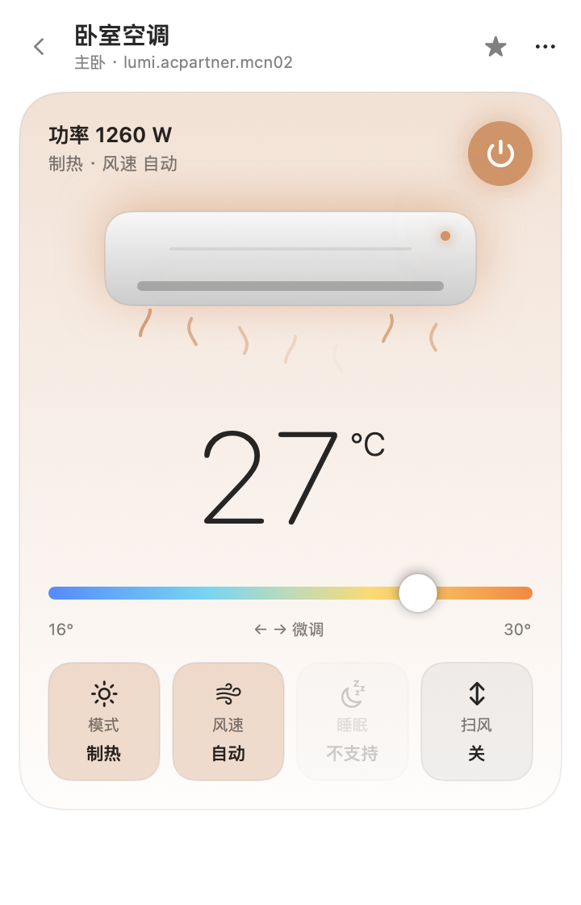
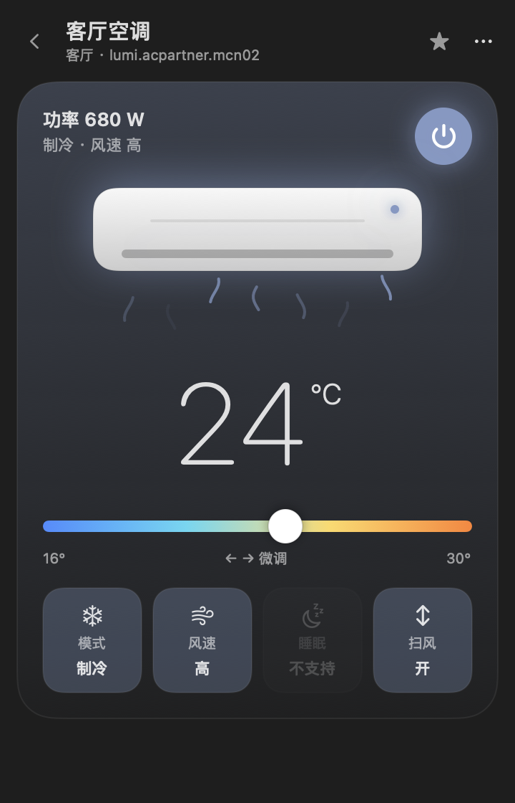
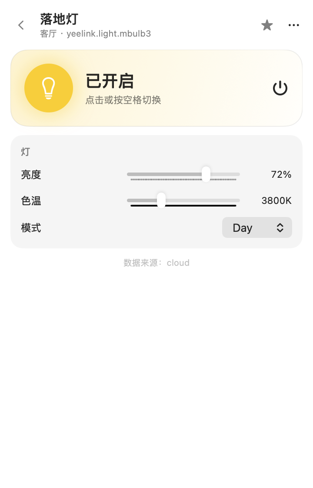
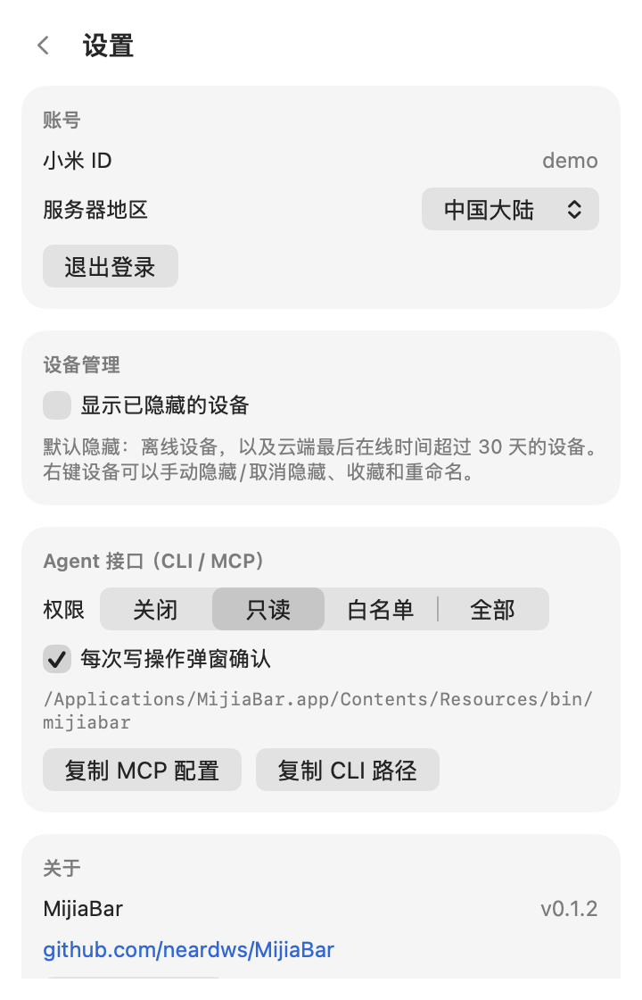

# MijiaBar · 米家菜单栏

把米家（小米智能家居）设备搬进 macOS 菜单栏。扫码登录，自动拉取设备，空调、灯、插座、风扇、取暖器、除湿机都能直接在 Mac 上控制；还自带 CLI 和 MCP 服务器，可以让 Claude、Cursor 等 Agent 来控制设备。

> 非小米官方项目。使用与米家 App 相同的云端接口和局域网 miIO 协议。

<p align="center">
  
  
  
</p>
<p align="center"><b>深色模式 / Dark</b><br>
  
  
  
</p>
<p align="center">
  
  
  
</p>

## 功能

- **扫码登录**：用米家 App 扫一扫即可，不用输密码；默认中国大陆服务器，可切换欧洲/美国/新加坡等地区。凭据只存在 macOS 钥匙串。
- **自动获取设备**：拉取所有家庭、房间和设备（含共享设备），带在线状态、型号和局域网 token。
- **双通道控制**：MIoT 设备走小米云 `miotspec` 接口，失败时回落到局域网 miIO；空调伴侣（`lumi.acpartner.*`）使用旧版命令并优先走局域网。
- **按规格自动生成控件**：从 [miot-spec.org](https://home.miot-spec.com/) 拉取每个型号的规格，开关、滑块、选项菜单都自动生成；空调使用专门设计的大卡片。
- **设备管理**：按房间分组、收藏置顶、搜索、重命名、手动隐藏；离线和久未使用的设备默认收起。
- **好看也好用**：自动跟随系统浅色/深色外观；圆角卡片，温度大字和蓝到橙的渐变滑条，空调出风动画，底部一排模式/风速/睡眠/扫风按钮；菜单栏显示收藏空调的温度。
- **键盘操作**：`↑/↓` 选择，`↩` 打开，`空格` 开关，`/` 搜索，`Esc` 返回，详情页 `←/→` 调温度。
- **乐观更新**：点了立刻生效，失败自动回滚并提示。
- **Agent 接口**：`mijiabar` CLI 和 `mijiabar mcp`（stdio MCP），有关闭/只读/白名单/全部四档权限，写操作可以弹窗确认。

## 安装

1. 从 [Releases](https://github.com/neardws/MijiaBar/releases) 下载 `MijiaBar-x.y.z.dmg`，把 MijiaBar 拖进「应用程序」，直接打开即可。正式版 DMG 已用 Developer ID 签名并通过 Apple 公证。
2. 第一次控制设备时，macOS 会询问「本地网络」权限，请允许（局域网直连需要）。

> GitHub Actions 自动构建的 `*-unsigned.dmg` 和自己用源码打包的版本是 ad-hoc 签名、没有公证，首次打开前需要执行
> `xattr -dr com.apple.quarantine /Applications/MijiaBar.app`，或者在 Finder 里右键 →「打开」。

系统要求：macOS 14 及以上，Apple 芯片和 Intel 都支持。

## 登录

点菜单栏的 🏠 图标，会显示一个二维码：

1. 确认地区是「中国大陆」（如果你的米家账号在海外服务器，先切换地区）。
2. 打开手机上的 **米家 App** → 右上角「+」→「扫一扫」，扫码并在手机上确认。
3. 登录成功后会自动拉取设备列表。

登录过期（一般几周）时会提示重新扫码。

## 默认隐藏规则

满足任一条件的设备默认收起到列表底部（点「显示」或眼睛按钮可以展开）：

- 云端 `isOnline = false`（离线）；
- 云端返回了最后在线时间（`last_online` 等字段），且超过 30 天。

右键设备可以手动「隐藏 / 取消隐藏」，手动设置优先于自动规则。

## Agent 接口

CLI 在 app 包里：`/Applications/MijiaBar.app/Contents/Resources/bin/mijiabar`。建议做个软链接：

```bash
sudo ln -sf /Applications/MijiaBar.app/Contents/Resources/bin/mijiabar /usr/local/bin/mijiabar
```

```bash
mijiabar list                          # 列出设备（--all 包括隐藏的，--refresh 从云端重新拉）
mijiabar get 客厅空调                   # 读状态，返回 JSON（属性 key、取值范围、选项）
mijiabar set 客厅空调 tar_temp 26       # 设置属性（空调伴侣：power/mode/tar_temp/fan_level/ver_swing）
mijiabar set 落地灯 on false            # MIoT 设备：属性可以写 key（2.1）、名称（on）或 服务.属性
mijiabar action 扫地机 2.1              # 执行 MIoT 动作
mijiabar mcp                           # 作为 stdio MCP 服务器运行
```

MCP 工具：`list_devices`、`get_device_state`、`set_property`、`run_action`。

**权限**：在 MijiaBar「设置 → Agent 接口」里选择：

| 模式 | 说明 |
| --- | --- |
| 关闭 | Agent 什么都不能做 |
| 只读（默认） | 只能列设备、读状态 |
| 白名单 | 只能控制你勾选的设备 |
| 全部 | 可以控制所有设备 |

开启「每次写操作弹窗确认」后，Agent 每次控制设备都会弹出系统对话框，等你点「允许」。

### Claude Desktop / Claude Code

`~/Library/Application Support/Claude/claude_desktop_config.json`：

```json
{
  "mcpServers": {
    "mijia": {
      "command": "/Applications/MijiaBar.app/Contents/Resources/bin/mijiabar",
      "args": ["mcp"]
    }
  }
}
```

Claude Code：`claude mcp add mijia -- /Applications/MijiaBar.app/Contents/Resources/bin/mijiabar mcp`

### Cursor

`~/.cursor/mcp.json` 写入同样的 `mcpServers` 配置即可。设置页的「复制 MCP 配置」按钮会直接复制这段 JSON。

> CLI 第一次读取钥匙串里的登录信息时，macOS 可能会弹窗询问，选「始终允许」。

## 从源码构建

```bash
git clone https://github.com/neardws/MijiaBar && cd MijiaBar
swift build                         # 调试构建
scripts/package.sh                  # 生成 dist/MijiaBar.app 和 DMG（有 Developer ID 时自动签名+公证）
# 可选环境变量：SIGN_IDENTITY（"-" 强制 ad-hoc）、NOTARY_PROFILE（notarytool 钥匙串配置名，默认 MijiaBar-notary）、VERSION
.build/debug/MijiaBarApp --snapshot docs/screenshots   # 用演示数据重新生成截图
```

项目结构：

- `Sources/MijiaCore`：小米云 API（RC4 签名）、扫码登录、miIO 局域网协议、MIoT 规格、设备控制
- `Sources/MijiaBarApp`：SwiftUI 菜单栏应用
- `Sources/mijiabar`：CLI 和 MCP 服务器

数据存放：登录凭据在钥匙串（`com.neardws.MijiaBar`）；设备缓存、偏好和规格缓存在 `~/Library/Application Support/MijiaBar/`（文件权限 600）。

## 致谢

协议细节参考了 [python-miio](https://github.com/rytilahti/python-miio)、[Xiaomi-cloud-tokens-extractor](https://github.com/PiotrMachowski/Xiaomi-cloud-tokens-extractor) 和 [ha_xiaomi_home](https://github.com/XiaoMi/ha_xiaomi_home)。界面灵感来自 [@the_mcnaveen](https://x.com/the_mcnaveen) 的空调菜单栏应用。

---

## English

**MijiaBar** is a macOS menu bar app for Xiaomi / Mi Home devices.

- QR-code sign-in with the Mi Home app (China server by default, region switchable); credentials stored in Keychain.
- Auto-fetches homes, rooms and devices; controls them via Xiaomi cloud MIoT RPC with LAN miIO fallback (legacy commands for `lumi.acpartner.*`).
- Controls are generated from each model's MIoT spec; air conditioners get a dedicated card with a big temperature readout, a blue-to-orange slider and an animated unit.
- Favorites, rooms, search, rename, and auto-hiding of offline or long-unused devices.
- Agent interface: `mijiabar list|get|set|action` CLI and an stdio MCP server (`mijiabar mcp`) with a disabled / read-only / allowlist / full policy and optional confirmation dialogs.

Install: download the DMG from Releases, drag the app to Applications, and open it — release DMGs are Developer ID signed and notarized (CI `-unsigned` builds need `xattr -dr com.apple.quarantine /Applications/MijiaBar.app`). Requires macOS 14+. MIT licensed.
