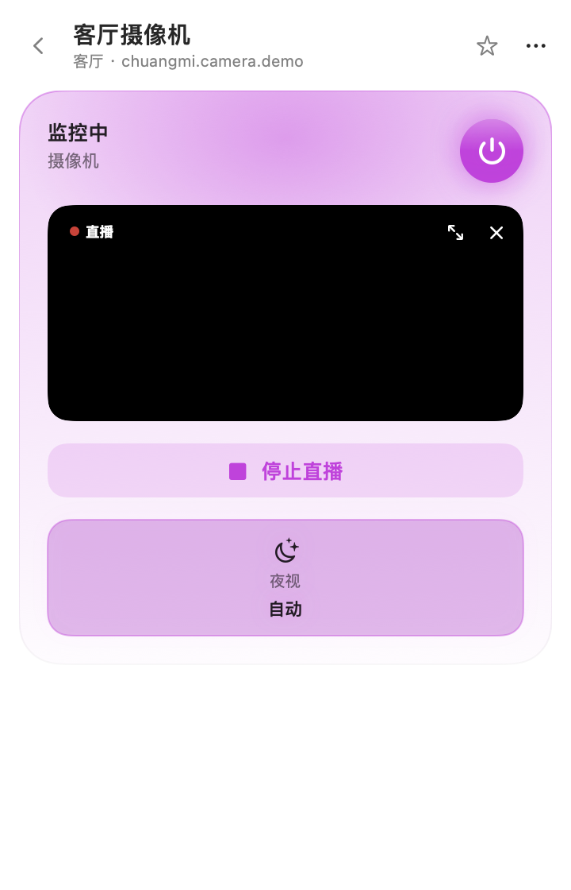
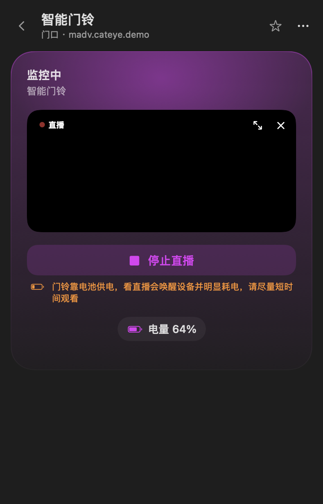

<h1 align="center">MijiaBar</h1>
<p align="center">Управляйте устройствами Xiaomi Mi Home из строки меню macOS — или доверьте это AI-агентам.</p>

<p align="center">
  <a href="https://github.com/neardws/MijiaBar/releases/latest"></a>
  <a href="https://github.com/neardws/MijiaBar/releases"></a>
  <a href="LICENSE"></a>
  
  
  
  <a href="https://github.com/neardws/MijiaBar/actions/workflows/build.yml"></a>
  <a href="https://github.com/neardws/MijiaBar/stargazers"></a>
</p>

<p align="center"><a href="README.md">English</a> · <a href="README.zh-CN.md">简体中文</a> · <a href="README.zh-TW.md">繁體中文</a> · <b>Русский</b> · <a href="README.de.md">Deutsch</a> · <a href="README.fr.md">Français</a></p>

> Неофициальный проект, не связан с Xiaomi. Использует то же облачное API, что и приложение Mi Home, а также локальный протокол miIO.

<p align="center"></p>

[Возможности](#возможности) · [Скриншоты](#скриншоты) · [Установка](#установка) · [Вход](#вход) · [Автоматически скрытые устройства](#автоматически-скрытые-устройства) · [Видео с камер](#видео-с-камер) · [Агенты / MCP](#агенты--mcp) · [Сборка из исходников](#сборка-из-исходников) · [Где хранятся данные](#где-хранятся-данные) · [Благодарности](#благодарности)

## Возможности

- **Вход по QR-коду** — отсканируйте в приложении Mi Home, без пароля. По умолчанию сервер «Материковый Китай»; Европа, США, Россия, Сингапур и Индия — в один клик. Данные входа хранятся в связке ключей macOS.
- **Автоматический список устройств** — все дома, комнаты и общие устройства со статусом сети. Устройства не в сети и давно не используемые скрыты по умолчанию.
- **Отдельная страница для каждого типа** — кондиционер, вентилятор, свет, розетка, телевизор, колонка, камера, принтер, кухонная техника, фильтр для воды, обогреватель, осушитель и датчики, у каждого своя скевоморфная иллюстрация.
- **Сдержанная анимация** — быстрые пружины без отскока (< 300 мс); лопасти вентилятора крутятся по скорости, экран ТВ светится, обогреватель излучает тепло; кнопка питания даёт волну; ползунки следуют за курсором, примагничиваются и дают отклик трекпада. Учитывается «Уменьшение движения».
- **Клавиатура** — `↑/↓` выбор, `↩` открыть, `Пробел` питание, `←/→` основной ползунок, `/` поиск, `Esc` назад, `⌘Q` выход.
- **Светлая и тёмная темы** — семантические цвета системы.
- **9 языков интерфейса** — 简体中文, 繁體中文, English, Deutsch, Français, Español, Italiano, Русский, 日本語; язык по умолчанию зависит от региона.
- **Интерфейс для агентов** — CLI `mijiabar` и stdio MCP-сервер; по умолчанию только чтение, есть белый список / полный доступ и диалоги подтверждения.
- **Два канала управления** — облачный MIoT RPC с запасным локальным miIO; AC partner (`lumi.acpartner.*`) управляется устаревшими локальными командами.

## Скриншоты

<p align="center">
  
  
  
</p>
<p align="center"><b>Тёмная тема</b><br>
  
  
  
</p>
<p align="center">
  
  
  
</p>

## Установка

1. Скачайте `MijiaBar-x.y.z.dmg` из [Releases](https://github.com/neardws/MijiaBar/releases/latest), перетащите MijiaBar в «Программы» и откройте. Релизные DMG подписаны Developer ID и нотаризованы Apple.
2. При первом управлении устройством разрешите доступ к **локальной сети** (нужно для управления по LAN).

> Сборки CI `*-unsigned.dmg` и локальные сборки подписаны ad-hoc; перед первым запуском выполните `xattr -dr com.apple.quarantine /Applications/MijiaBar.app`.

Требуется macOS 14 или новее, Apple silicon или Intel.

## Вход

1. Нажмите значок 🏠 в строке меню — появится QR-код.
2. Выберите регион сервера (по умолчанию «Материковый Китай»).
3. В приложении **Mi Home** нажмите **+ → Сканировать**, отсканируйте код и подтвердите на телефоне. Устройства загрузятся автоматически.

## Автоматически скрытые устройства

Устройство по умолчанию сворачивается в конец списка, если выполняется любое условие:

- облако сообщает, что оно не в сети (`isOnline = false`);
- облако возвращает время последнего подключения (`last_online` / `lastOnline` / `last_online_time`) старше 30 дней.

Нажмите кнопку с глазом или **Показать**, либо включите **Настройки → Устройства → Показывать скрытые устройства**. Правый клик по устройству позволяет скрыть или показать его вручную — ручной выбор всегда важнее автоматического правила.

## Видео с камер

- В карточках камер и дверных звонков есть кнопка **Смотреть**: видео идёт прямо в карточке, кнопка увеличения открывает отдельное окно с изменяемым размером.
- Используется встроенный [go2rtc](https://github.com/AlexxIT/go2rtc) (MIT, официальный релиз, SHA-256 проверяется при сборке), который работает только во время просмотра: слушает `127.0.0.1` на случайном порту, RTSP / WebRTC / HomeKit (mDNS) отключены, доступны только плеер и `/api/ws`; останавливается через 20 с после закрытия плеера и завершается при выходе из MijiaBar.
- Вход использует QR-сессию: MijiaBar хранит `passToken` из QR-входа в связке ключей и передаёт его go2rtc через временный `go2rtc.yaml` (права 600, удаляется сразу после чтения). Для сессий до v0.1.8 нужно отсканировать QR ещё раз (**Настройки → Видео с камер**).
- Ключи запрашиваются в облаке Xiaomi при каждом подключении, видео идёт с камеры через P2P Xiaomi. Ничего не записывается. Звонки на батарее просыпаются и быстрее разряжаются. Агенты / MCP не имеют доступа к камерам.

<p align="center">
  
  
</p>

## Агенты / MCP

Откройте **Настройки → Интерфейс агента**, нажмите **Копировать инструкцию** и вставьте текст в Claude Code, Codex, Cursor или другой агент. Агент сам найдёт встроенный CLI, зарегистрирует MCP-сервер в своей конфигурации и проверит работу, получив список устройств. Тот же текст (с подставленным путём) выводит `mijiabar setup-prompt`:

```text
Прочитай https://raw.githubusercontent.com/neardws/MijiaBar/main/docs/AGENT_SETUP.ru.md и по этой инструкции подключи MijiaBar как свой MCP-инструмент.
Путь к CLI: /Applications/MijiaBar.app/Contents/Resources/bin/mijiabar
Не меняй состояние устройств без моего согласия.
```

Полная пошаговая инструкция для агентов: [docs/AGENT_SETUP.ru.md](docs/AGENT_SETUP.ru.md)

### Права доступа

| | |
| --- | --- |
| Выкл. | Агенты ничего не могут |
| Чтение (по умолчанию) | Только список устройств и чтение состояния |
| Белый список | Управление только отмеченными устройствами |
| Полный | Управление всеми устройствами |

Если включено **Подтверждать каждую запись**, каждое изменение агента показывает диалог macOS, который нужно одобрить.

### CLI

```bash
mijiabar list                     # list devices (--all, --refresh)
mijiabar get <device>             # read state as JSON
mijiabar set <device> <prop> <value>
mijiabar action <device> <action> [JSON array]
mijiabar mcp                      # stdio MCP server
mijiabar setup-prompt             # print the agent setup instructions
```

MCP-инструменты: `list_devices`, `get_device_state`, `set_property`, `run_action`.

## Сборка из исходников

```bash
git clone https://github.com/neardws/MijiaBar && cd MijiaBar
swift build
.build/debug/MijiaBarApp --snapshot docs/screenshots   # demo-data screenshots
scripts/package.sh   # dist/MijiaBar.app + DMG (signs & notarizes when a Developer ID is available)
# env: VERSION, SIGN_IDENTITY ("-" = ad-hoc), NOTARY_PROFILE (default MijiaBar-notary)
```

Структура: `Sources/MijiaCore` (облачное API, вход по QR, miIO, спецификации MIoT), `Sources/MijiaBarApp` (приложение SwiftUI), `Sources/mijiabar` (CLI + MCP). Переводы — в `i18n/*.tsv`; после правки запустите `scripts/gen-i18n.py`.

## Где хранятся данные

- Сессия входа: связка ключей macOS, служба `com.neardws.MijiaBar` (учётная запись `session`). Удаляется при выходе.
- Кэш устройств `devices.json`, настройки `prefs.json` (избранное, псевдонимы, скрытие, регион), политика агента `agent.json` и кэш спецификаций MIoT `spec-index.json` + `specs/<model>.json` — всё в `~/Library/Application Support/MijiaBar/`, права доступа 600.
- Язык интерфейса: `MijiaBarLang` в UserDefaults (общий для приложения и CLI; переменная `MIJIABAR_LANG` имеет приоритет).
- Данные отправляются только на серверы Xiaomi, на ваши устройства в локальной сети и на miot-spec.org (загрузка публичных спецификаций).

## Благодарности

Дизайн анимации — [@skyswordw](https://github.com/skyswordw) ([#1](https://github.com/neardws/MijiaBar/pull/1)). Детали протоколов — из [python-miio](https://github.com/rytilahti/python-miio), [Xiaomi-cloud-tokens-extractor](https://github.com/PiotrMachowski/Xiaomi-cloud-tokens-extractor) и [ha_xiaomi_home](https://github.com/XiaoMi/ha_xiaomi_home). Интерфейс вдохновлён приложением для кондиционера от [@the_mcnaveen](https://x.com/the_mcnaveen).

Лицензия MIT.
