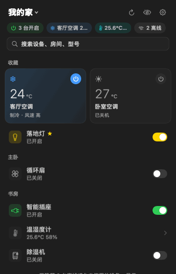
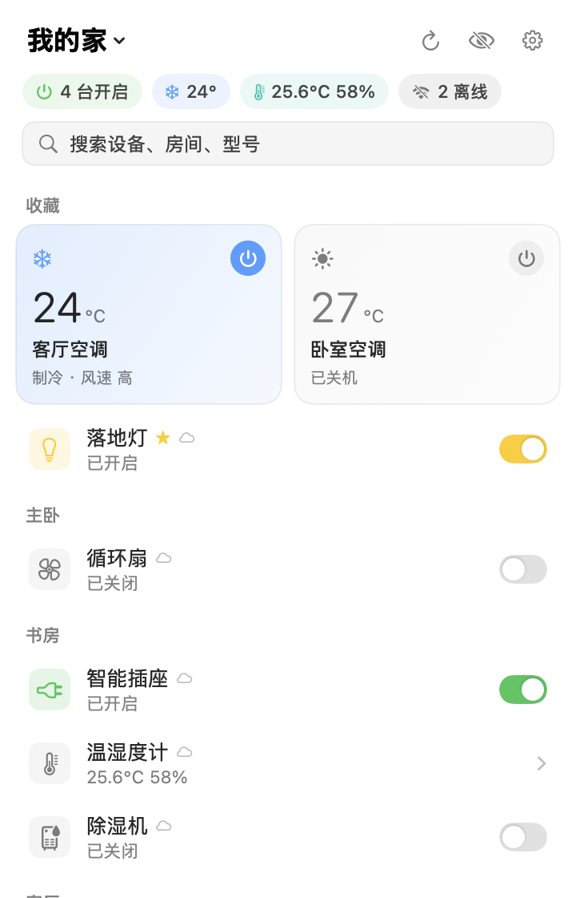
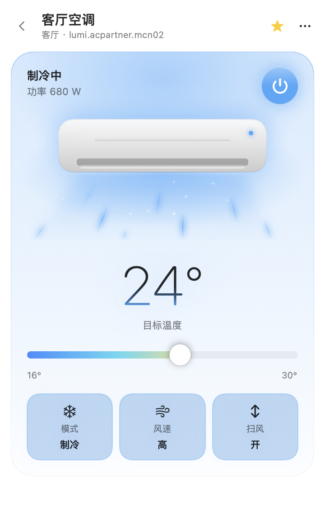
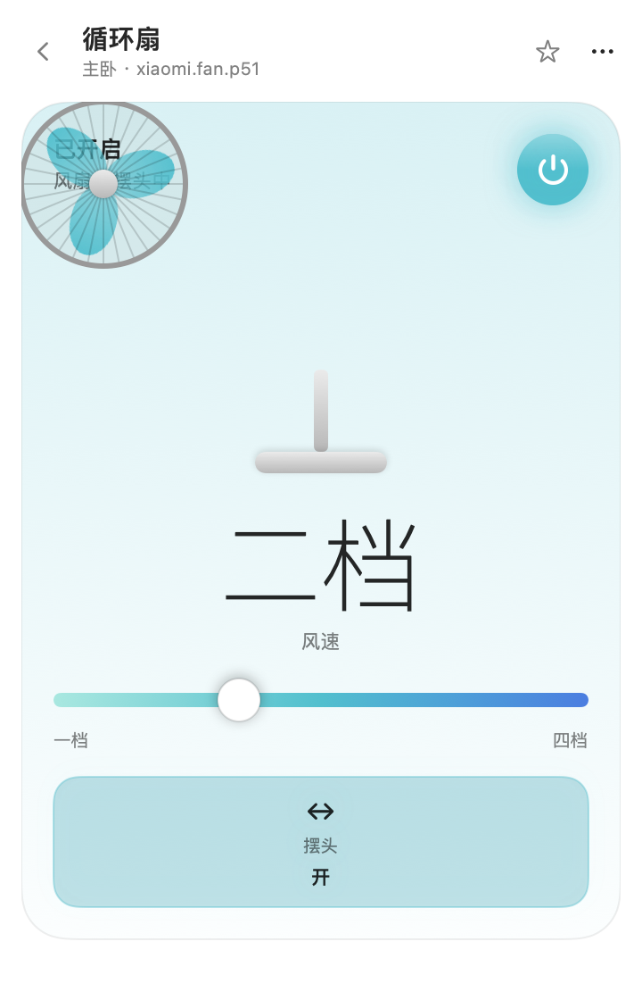
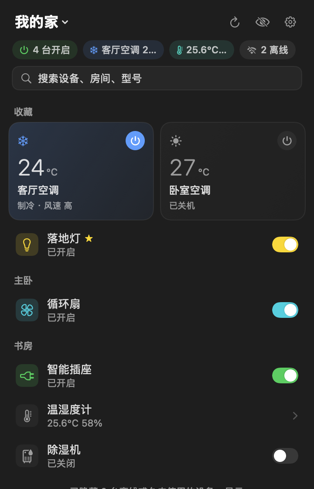
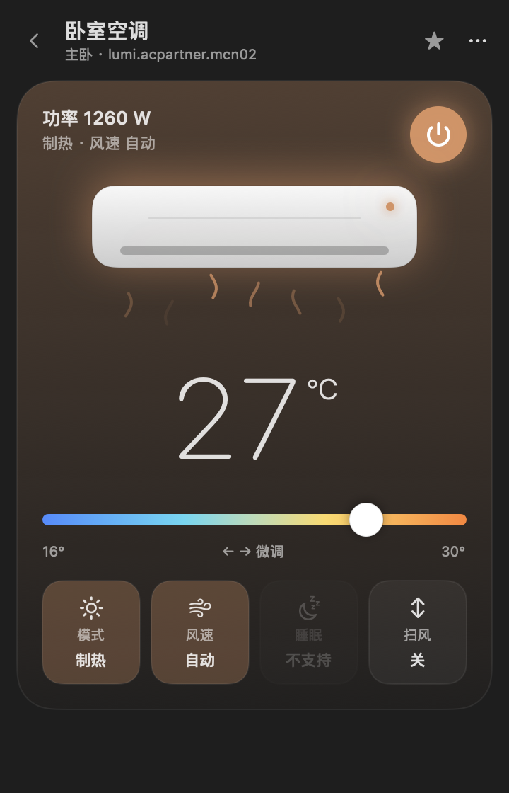
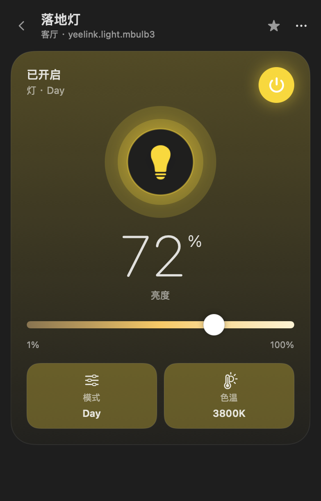
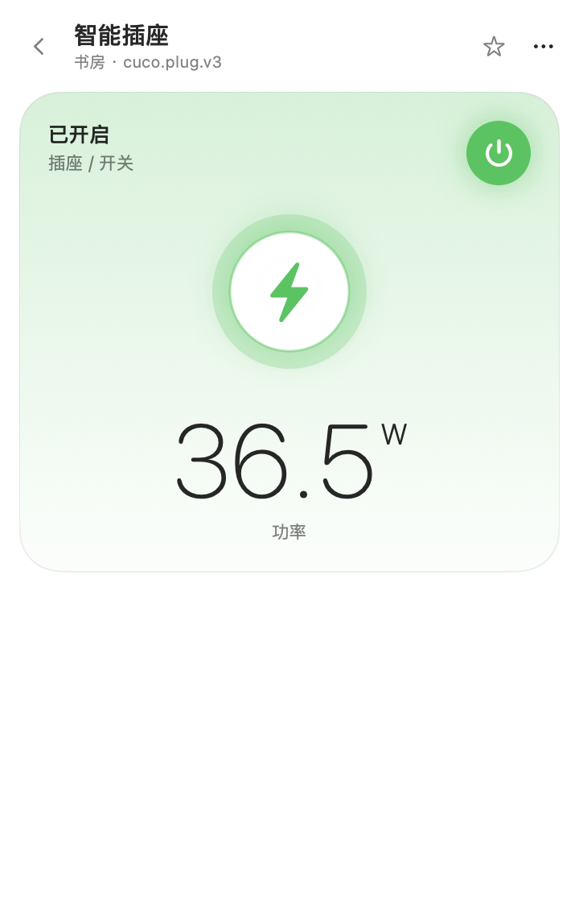
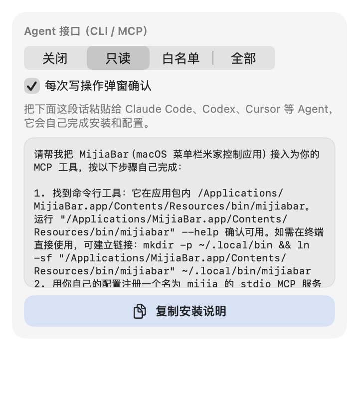

<h1 align="center">MijiaBar</h1>
<p align="center">在 macOS 菜单栏控制米家设备，也可以交给 AI Agent 来控制。</p>

<p align="center">
  <a href="https://github.com/neardws/MijiaBar/releases/latest"></a>
  <a href="https://github.com/neardws/MijiaBar/releases"></a>
  <a href="LICENSE"></a>
  
  
  
  <a href="https://github.com/neardws/MijiaBar/actions/workflows/build.yml"></a>
  <a href="https://github.com/neardws/MijiaBar/stargazers"></a>
</p>

<p align="center"><a href="README.md">English</a> · <b>简体中文</b> · <a href="README.zh-TW.md">繁體中文</a> · <a href="README.ru.md">Русский</a> · <a href="README.de.md">Deutsch</a> · <a href="README.fr.md">Français</a></p>

> 非小米官方项目。使用与米家 App 相同的云端接口和局域网 miIO 协议。

<p align="center"></p>

[功能](#功能) · [截图](#截图) · [安装](#安装) · [登录](#登录) · [Agent / MCP](#agent--mcp) · [从源码构建](#从源码构建) · [致谢](#致谢)

## 功能

- **扫码登录**：用米家 App 扫一扫，无需密码。默认中国大陆服务器，也可切换欧洲、美国、俄罗斯、新加坡、印度。凭据只存在 macOS 钥匙串。
- **自动获取设备**：拉取所有家庭、房间和共享设备及在线状态；离线和久未使用的设备默认隐藏。
- **每类设备单独设计**：空调、风扇、灯、插座、电视、音箱、摄像机、打印机、厨房电器、净水器、取暖器、除湿机、传感器，各有拟物插画。
- **克制的动效**：无回弹的快速弹簧（< 300ms）；风扇按风速转动、电视屏幕发光、取暖器热浪；电源键涟漪；滑条 1:1 跟手、松手吸附、跨档触控板轻触。遵循「减弱动态效果」。
- **键盘优先**：`↑/↓` 选择、`↩` 打开、`空格` 开关、`←/→` 调节主滑条、`/` 搜索、`Esc` 返回、`⌘Q` 退出。
- **浅色 / 深色**：使用系统语义色，自动跟随外观。
- **9 种界面语言**：简体中文、繁體中文、English、Deutsch、Français、Español、Italiano、Русский、日本語，按地区推荐默认语言。
- **Agent 接口**：`mijiabar` 命令行和 stdio MCP 服务器，默认只读，可选白名单 / 全部权限，写操作可弹窗确认。
- **双通道控制**：小米云 MIoT RPC，失败时回落局域网 miIO；空调伴侣（`lumi.acpartner.*`）使用旧版局域网命令。

## 截图

<p align="center">
  
  
  
</p>
<p align="center"><b>深色模式</b><br>
  
  
  
</p>
<p align="center">
  
  
  
</p>

## 安装

1. 从 [Releases](https://github.com/neardws/MijiaBar/releases/latest) 下载 `MijiaBar-x.y.z.dmg`，把 MijiaBar 拖进「应用程序」后打开。正式版已用 Developer ID 签名并通过 Apple 公证。
2. 第一次控制设备时，请允许「本地网络」权限（局域网直连需要）。

> CI 构建的 `*-unsigned.dmg` 和自己本地打包的版本为 ad-hoc 签名，首次打开前执行 `xattr -dr com.apple.quarantine /Applications/MijiaBar.app`。

系统要求：macOS 14 及以上，支持 Apple 芯片和 Intel。

## 登录

1. 点菜单栏的 🏠 图标，会显示二维码。
2. 选择服务器地区（默认中国大陆）。
3. 打开手机 **米家 App** →「+」→「扫一扫」，扫码并在手机上确认，设备会自动加载。

## Agent / MCP

打开 **设置 → Agent 接口**，点 **复制安装说明**，粘贴给 Claude Code、Codex、Cursor 等 Agent。Agent 会自己找到内置 CLI、在自己的配置里注册 MCP 服务器，并列出设备完成验证。`mijiabar setup-prompt` 会输出同样的内容（路径已填好）：

```text
请帮我把 MijiaBar（macOS 菜单栏米家控制应用）接入为你的 MCP 工具，按以下步骤自己完成：

1. 找到命令行工具：它在应用包内 /Applications/MijiaBar.app/Contents/Resources/bin/mijiabar。运行 "/Applications/MijiaBar.app/Contents/Resources/bin/mijiabar" --help 确认可用。如需在终端直接使用，可建立链接：mkdir -p ~/.local/bin && ln -sf "/Applications/MijiaBar.app/Contents/Resources/bin/mijiabar" ~/.local/bin/mijiabar
2. 用你自己的配置注册一个名为 mijia 的 stdio MCP 服务器，命令为 "/Applications/MijiaBar.app/Contents/Resources/bin/mijiabar"，参数为 mcp：
   - Claude Code: claude mcp add --scope user mijia -- "/Applications/MijiaBar.app/Contents/Resources/bin/mijiabar" mcp
   - Codex: codex mcp add mijia -- "/Applications/MijiaBar.app/Contents/Resources/bin/mijiabar" mcp
     (~/.codex/config.toml:
      [mcp_servers.mijia]
      command = "/Applications/MijiaBar.app/Contents/Resources/bin/mijiabar"
      args = ["mcp"])
   - Cursor (~/.cursor/mcp.json), Claude Desktop, …:
     {"mcpServers": {"mijia": {"command": "/Applications/MijiaBar.app/Contents/Resources/bin/mijiabar", "args": ["mcp"]}}}
   注册后按需重新加载 MCP。
3. 可用工具：list_devices、get_device_state、set_property、run_action。权限由我在 MijiaBar → 设置 → Agent 接口 中控制：默认「只读」（写操作会被拒绝）；「白名单」只允许控制选中的设备；「全部」允许控制所有设备。开启「每次写操作弹窗确认」时，每次写操作都会在 Mac 上弹窗，需要我点允许。没有我的明确要求，不要改变任何设备的状态。
4. 验证：运行 "/Applications/MijiaBar.app/Contents/Resources/bin/mijiabar" list（或调用 list_devices），把设备列表给我看。如果提示未登录，请让我先在 MijiaBar 里扫码登录。
```

### 权限

| | |
| --- | --- |
| 关闭 | Agent 什么都不能做 |
| 只读（默认） | 只能列设备、读状态 |
| 白名单 | 只能控制你勾选的设备 |
| 全部 | 可以控制所有设备 |

开启 **每次写操作弹窗确认** 后，Agent 的每次控制都会弹出系统对话框，需要你点「允许」。

### 命令行

```bash
mijiabar list                     # list devices (--all, --refresh)
mijiabar get <device>             # read state as JSON
mijiabar set <device> <prop> <value>
mijiabar action <device> <action> [JSON array]
mijiabar mcp                      # stdio MCP server
mijiabar setup-prompt             # print the agent setup instructions
```

MCP 工具：`list_devices`、`get_device_state`、`set_property`、`run_action`。

## 从源码构建

```bash
git clone https://github.com/neardws/MijiaBar && cd MijiaBar
swift build
.build/debug/MijiaBarApp --snapshot docs/screenshots   # demo-data screenshots
scripts/package.sh   # dist/MijiaBar.app + DMG (signs & notarizes when a Developer ID is available)
# env: VERSION, SIGN_IDENTITY ("-" = ad-hoc), NOTARY_PROFILE (default MijiaBar-notary)
```

项目结构：`Sources/MijiaCore`（云端 API、扫码登录、miIO、MIoT 规格）、`Sources/MijiaBarApp`（SwiftUI 应用）、`Sources/mijiabar`（CLI + MCP）。翻译在 `i18n/*.tsv`，修改后运行 `scripts/gen-i18n.py`。

## 致谢

动效设计由 [@skyswordw](https://github.com/skyswordw) 贡献（[#1](https://github.com/neardws/MijiaBar/pull/1)）。协议细节参考 [python-miio](https://github.com/rytilahti/python-miio)、[Xiaomi-cloud-tokens-extractor](https://github.com/PiotrMachowski/Xiaomi-cloud-tokens-extractor) 和 [ha_xiaomi_home](https://github.com/XiaoMi/ha_xiaomi_home)。界面灵感来自 [@the_mcnaveen](https://x.com/the_mcnaveen) 的空调菜单栏应用。

MIT 许可证。
